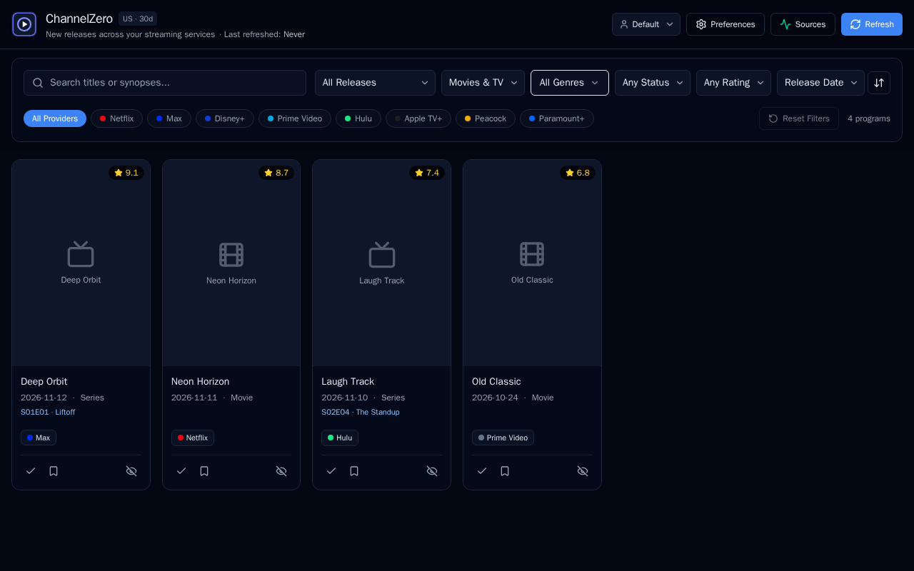

# ChannelZero

A locally hosted streaming dashboard that highlights new releases across major streaming providers. Designed to run as a single OCI container on Linux, WSL, Docker, Podman, and homelab platforms like TrueNAS.

[](LICENSE)



---

## Features

- **Multi-Source New Releases Feed**: Aggregates and de-duplicates new releases across multiple upstream sources, prioritized by tier:
  1. **Anonymous / Free (Zero Setup)**: **TVmaze** works out of the box with no API key for TV releases and major streaming web channels.
  2. **Free-Tier (API Key)**: **TMDB** enables movies, TV series, and regional streaming provider availability. **OMDb** provides IMDb, Rotten Tomatoes, and Metacritic rating breakdowns.
  3. **Optional / Paid-Tier**: **Watchmode** enriches titles with direct streaming deep links.
- **Provider Deep Links & Playback**:
  - Clicking the **poster play overlay** or a **provider badge** launches the title directly on the streaming service (opening safely in a new tab) and automatically records the title as **Seen**.
  - 3-step fallback: direct deep link (Watchmode / official site) &rarr; provider search page &rarr; metadata show page.
- **Ratings Display**: Shows composite ratings on cards and complete per-source breakdown (IMDb, Rotten Tomatoes, Metacritic, TVmaze, TMDB) in the detail modal.
- **Responsive Dashboard Controls**: Search titles/synopses, filter by provider, media type (Movies vs. TV), release kind (New Titles vs. New Episodes), genre, rating, and watch status.
- **Lightweight Profiles & Curation**:
  - Switch or create profiles with zero login friction.
  - Per-profile `region` and `new_release_days` overrides in **Preferences** (with a sync prompt on region change to immediately fetch metadata for the new region).
  - Automatically track **Seen** items on click; manually mark as **Watched** or save to **Watchlist**.
  - **Not Interested** hides specific titles from the dashboard.
  - **Not Interested in Genre** allows hiding entire genres/categories, with a full undo/unhide panel under **Preferences**.
- **API & Sync Status Panel**: In-app status dialog shows upstream API health, configured keys, last sync timestamps, item counts, and manual refresh controls.
- **Homelab & TrueNAS Friendly**:
  - Single self-contained OCI container (`Dockerfile` / `compose.yaml`).
  - SQLite database persisted via a single `/data` volume mount.
  - Non-root container execution with `PUID`/`PGID` permission mapping.
  - Built-in container healthcheck endpoint (`/api/health`).

---

## Quick Start (Docker / WSL / Linux)

### Using Docker Compose (Recommended)

1. Clone the repository:

   ```bash
   git clone https://github.com/channelzero/channelzero.git
   cd channelzero
   ```

2. (Optional) Copy `.env.example` to `.env` and set your preferred timezone, region, and optional API keys:

   ```bash
   cp .env.example .env
   ```

3. Start ChannelZero:

   ```bash
   docker compose up -d
   ```

   For local development with automatic rebuild & redeploy on file changes:

   ```bash
   docker compose up --watch --build
   ```

4. Open your browser to [http://localhost:8080](http://localhost:8080).

---

### Using Docker Run

```bash
docker run -d \
  --name channelzero \
  --restart unless-stopped \
  -p 8080:8080 \
  -e TZ="America/New_York" \
  -e REGION="US" \
  -e PUID=1000 \
  -e PGID=1000 \
  -v channelzero_data:/data \
  channelzero:latest
```

---

### Using Podman

ChannelZero's `Dockerfile` is fully compatible with Podman:

```bash
podman build -t channelzero:latest .
podman run -d \
  --name channelzero \
  --restart unless-stopped \
  -p 8080:8080 \
  -e TZ="America/New_York" \
  -e REGION="US" \
  -v channelzero_data:/data:Z \
  channelzero:latest
```

---

### Homelab / TrueNAS Custom App Setup

When setting up a **Custom App** in TrueNAS SCALE / Electric Eel:

1. **Application Name**: `channelzero`
2. **Image repository**: `channelzero` (or your registry tag), Tag: `latest`
3. **Port Forwarding**: Container Port `8080` &rarr; Node Port (e.g. `8080`)
4. **Storage Volume**:
   - Host Path (e.g., `/mnt/tank/apps/channelzero/data`) &rarr; Mount Path: `/data`
5. **Environment Variables**:
   - `TZ`: Your local timezone (e.g., `America/New_York`)
   - `REGION`: `US` (or your 2-letter country code)
   - `PUID`: `1000` (or your TrueNAS apps UID)
   - `PGID`: `1000` (or your TrueNAS apps GID)
   - Optional API keys: `TMDB_API_KEY`, `OMDB_API_KEY`, `WATCHMODE_API_KEY`

---

## Configuration Reference

Configuration can be provided via environment variables, secret files (`*_FILE`), or a mounted JSON configuration file (`/config/config.json`) validated against [`config.schema.json`](config.schema.json).

| Environment Variable     | Default             | Description                                                              |
| ------------------------ | ------------------- | ------------------------------------------------------------------------ |
| `PORT`                   | `8080`              | HTTP port the server listens on                                          |
| `TZ`                     | `America/New_York`  | IANA timezone for release day calculations                               |
| `REGION`                 | `US`                | ISO 3166-1 alpha-2 country code for streaming availability               |
| `NEW_RELEASE_DAYS`       | `30`                | Number of days in the new release lookback window                        |
| `REFRESH_INTERVAL_HOURS` | `6`                 | Hours between automatic background metadata refreshes                    |
| `PROVIDERS`              | _Major US services_ | Comma-separated list of enabled providers in priority order              |
| `TVMAZE_ENABLED`         | `true`              | Anonymous free TV releases (no key required)                             |
| `TMDB_ENABLED`           | `false`             | Free-key movies, TV, and streaming availability (`true` when key is set) |
| `TMDB_API_KEY`           | _(empty)_           | Free TMDB API key or v4 access token                                     |
| `OMDB_ENABLED`           | `false`             | Free-key rating enrichment (IMDb, Rotten Tomatoes, Metacritic)           |
| `OMDB_API_KEY`           | _(empty)_           | Free-tier OMDb API key                                                   |
| `WATCHMODE_ENABLED`      | `false`             | Direct streaming deep-link enrichment                                    |
| `WATCHMODE_API_KEY`      | _(empty)_           | Free/paid-tier Watchmode API key                                         |
| `PUID` / `PGID`          | `1000` / `1000`     | User and group IDs for container execution & volume permissions          |

> **Container Secrets**: For sensitive keys, you can provide file paths via `TMDB_API_KEY_FILE`, `OMDB_API_KEY_FILE`, and `WATCHMODE_API_KEY_FILE` (useful with Docker secrets and TrueNAS mounted secrets).
>
> **Profile Overrides**: Server defaults for `REGION` and `NEW_RELEASE_DAYS` can be customized per profile under **Preferences**. Changing a profile's region prompts to trigger a sync so releases for that region are fetched immediately.

---

## Supported Streaming Providers

- **Netflix** (`netflix`)
- **Max** (`max`)
- **Disney+** (`disney_plus`)
- **Prime Video** (`prime_video`)
- **Hulu** (`hulu`)
- **Apple TV+** (`apple_tv_plus`)
- **Peacock** (`peacock`)
- **Paramount+** (`paramount_plus`)

---

## Architecture

ChannelZero is packaged as a single multi-stage OCI image containing:

- **Backend**: Rust server (`axum`, `tokio`, `sqlx`, `reqwest`) handling background scheduling, multi-source metadata fetching, de-duplication, SQLite persistence, and serving the REST API.
- **Frontend**: Single-page application built with React, TypeScript, Tailwind CSS, and Lucide icons, compiled directly into static assets served by the Rust backend.
- **Database**: SQLite database stored in `/data/channelzero.db` with WAL mode enabled for fast concurrent read/write performance.

---

## Development & Testing

### Containerized Development (`just` + Docker)

To run all Rust, Node 24, Prettier, and Playwright checks inside containers without installing local toolchains:

```bash
# Build the cached Rust dev image (rustfmt, clippy, cargo-llvm-cov) once
just dev-image

# Run all linters and formatters (Rust fmt/clippy, ESLint, tsc, Prettier)
just lint

# Run unit tests (Rust + Vitest)
just test

# Run full-stack Playwright E2E tests in a container
just e2e

# Run the full local CI suite (lint + test + e2e)
just ci
```

### Development & Testing Commands

#### Frontend

```bash
cd frontend
npm run typecheck
npm run lint
npm test
npm run build
```

#### Formatting

```bash
frontend/node_modules/.bin/prettier --check .
```

#### Playwright E2E

```bash
cd playwright && npm run test:e2e
```

#### Rust

```bash
cargo fmt --check
cargo clippy --all-targets -- -D warnings
cargo test
```

### Full Container Build

```bash
docker build -t channelzero:latest .
```

### Verify Container Health

```bash
curl http://localhost:8080/api/health
# Response: {"status":"ok","version":"0.1.0"}
```
